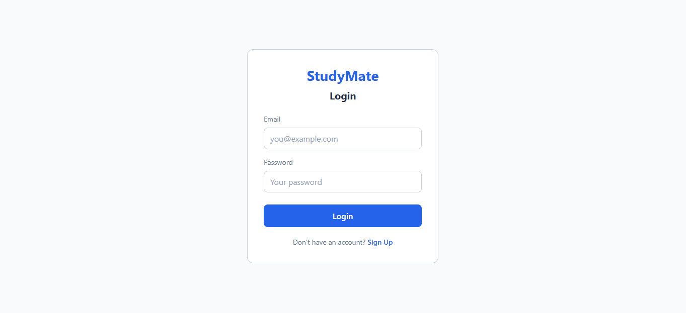
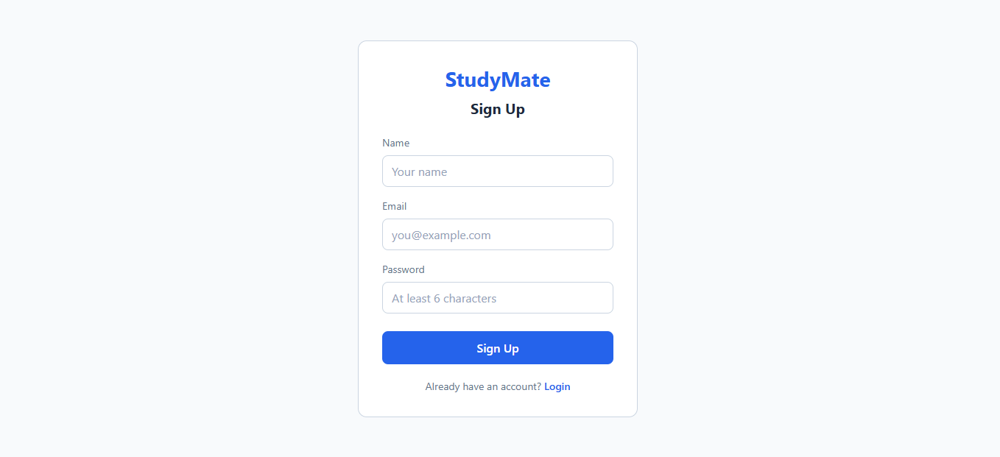
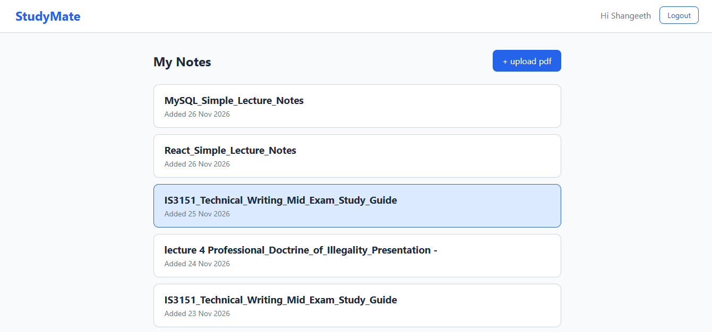
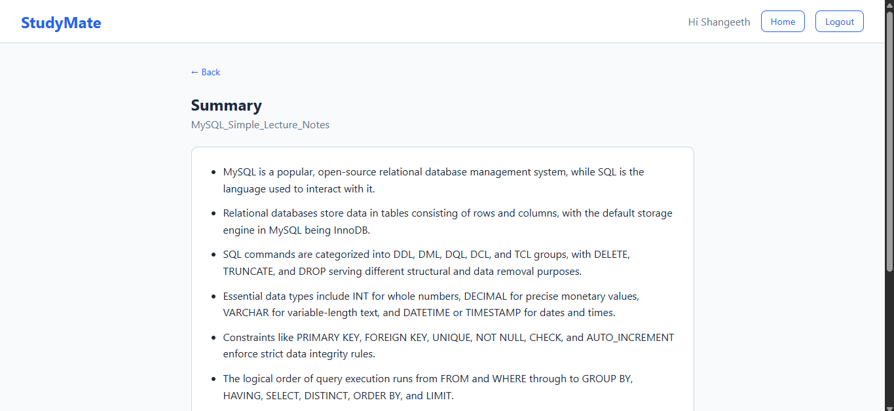
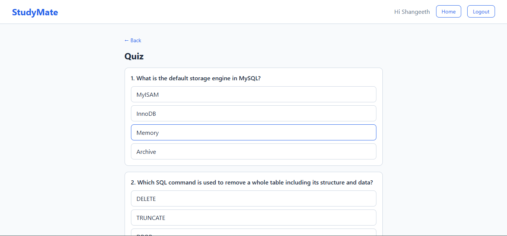
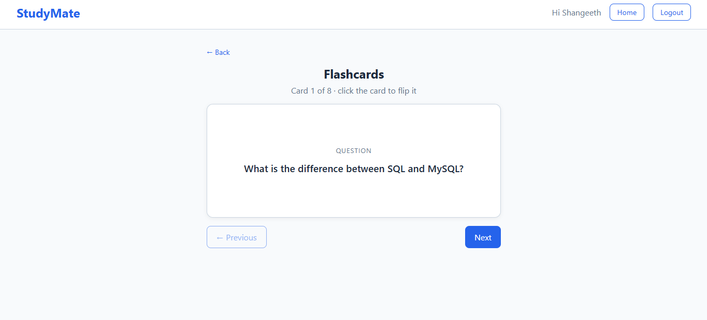

# 📚 StudyMate – AI Study Helper

StudyMate turns your lecture notes into study material. Upload a PDF and it gives you an **AI summary**, a **multiple-choice quiz** and **flashcards** in a few seconds.

🔗 **Live demo:** https://studymate-beryl.vercel.app

---

## ✨ Features

- 🔐 **Sign up / log in** with JWT authentication (passwords hashed with bcrypt)
- 📄 **Upload PDF notes** (up to 4 MB). The text is extracted and saved, and the PDF file itself is not stored
- 📝 **AI summary**: 5–10 short bullet points made with Google Gemini
- ❓ **Quiz**: 5 multiple-choice questions with instant marking (green / red) and a score
- 🃏 **Flashcards**: 8 cards, click to flip, Previous / Next
- 🔒 **Private notes**: each user can only see and delete their own notes
- ⚡ **Generated once, saved forever**: the quiz and flashcards are made on first open and then loaded from the database

## 📸 Screenshots

| Login | Sign up |
|---|---|
|  |  |

| My Notes | Note Menu |
|---|---|
|  |  |

| Summary | Quiz | Flashcards |
|---|---|---|
|  |  |  |

## 🛠️ Tech Stack

| Part | Technology |
|---|---|
| Frontend | React (Vite), React Router, Axios, CSS |
| Backend | Node.js, Express |
| Database | MongoDB Atlas, Mongoose |
| Auth | JSON Web Tokens (JWT), bcryptjs |
| File upload | Multer (memory storage), pdf-parse |
| AI | Google Gemini API (`@google/genai`) with JSON-schema output |
| Hosting | Vercel (frontend + backend as a serverless function) |

## 🏗️ How it works

```
React (Vercel)  ──>  Express API (Vercel Function)  ──>  MongoDB Atlas
                               │
                               └──>  Google Gemini API
```

1. The user uploads a PDF → Multer keeps it in memory → pdf-parse extracts the text
2. The text is saved in MongoDB, and Gemini writes a summary
3. When the user opens Quiz or Flashcards for the first time, Gemini makes them (as JSON) and they are saved to the note
4. Every request after that reads the saved data, so there are no extra AI calls

## 🔌 API Endpoints

| Method | Endpoint | Description |
|---|---|---|
| POST | `/api/auth/register` | Create an account |
| POST | `/api/auth/login` | Log in, returns a JWT |
| GET | `/api/auth/me` | Current user (protected) |
| POST | `/api/notes` | Upload a PDF note (protected) |
| GET | `/api/notes` | List my notes (protected) |
| GET | `/api/notes/:id` | Get one note (protected, owner only) |
| DELETE | `/api/notes/:id` | Delete a note (protected, owner only) |
| POST | `/api/notes/:id/summary` | Make the summary if missing |
| POST | `/api/notes/:id/quiz` | Make or get the quiz |
| POST | `/api/notes/:id/flashcards` | Make or get the flashcards |

## 💻 Run it locally

**You need:** Node.js 20+, a MongoDB Atlas database, and a Gemini API key (free from [Google AI Studio](https://aistudio.google.com/)).

### 1. Clone

```bash
git clone https://github.com/shangeeth2k22/studymate.git
cd studymate
```

### 2. Backend

```bash
cd server
npm install
```

Create `server/.env`:

```env
MONGO_URI=your_mongodb_connection_string
JWT_SECRET=any_long_random_string
GEMINI_API_KEY=your_gemini_api_key
GEMINI_MODEL=gemini-3.5-flash-lite
```

```bash
npm run dev      # runs on http://localhost:5000
```

### 3. Frontend

```bash
cd client
npm install
npm run dev      # runs on http://localhost:5173
```

The client uses `http://localhost:5000/api` by default. To use another API, create `client/.env` with `VITE_API_URL=...`.

## 🚀 Deployment

Both parts are deployed on **Vercel** from this one repo:

- **Backend:** root directory `server`, Express preset, with the env variables above plus `CLIENT_URL` (the frontend URL, for CORS)
- **Frontend:** root directory `client`, Vite preset, with `VITE_API_URL` pointing to the backend `/api`. `client/vercel.json` sends every path to `index.html` so React Router works on refresh

## 📚 What I learned

- Building a REST API with Express, middleware and protected routes
- JWT authentication and keeping each user's data private (no IDOR)
- Getting structured JSON from an AI model with a JSON schema, and retrying when the API is busy (503 / 429)
- Fixing a race condition with an atomic MongoDB update (`findOneAndUpdate`)
- Deploying a MERN app on serverless hosting (connection reuse, CORS, environment variables, SPA rewrites)

## 👤 Author

**B. Shangeeth**, Computer Engineering undergraduate

GitHub: [@shangeeth2k22](https://github.com/shangeeth2k22)
